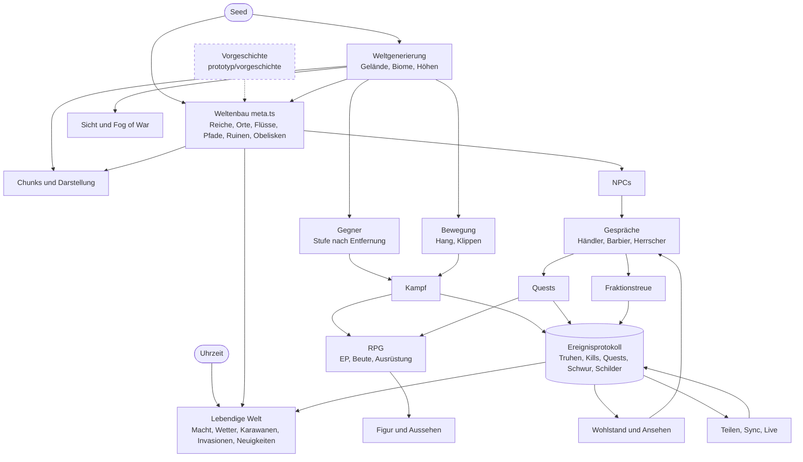

# Plan: Kern geradeziehen (ab M32)

Stand 2026-11-20 · Ergebnis einer Planungsrunde mit Alex · gilt vor allen weiteren Meilensteinen

## Ausgangslage

Seit Oktober sind 31 Meilensteine in kurzer Zeit entstanden. Das Ergebnis (Rückmeldung von Alex):

- **Zu viele Systeme zu schnell.** Keins ist fertig oder austariert, bei keinem ist gesichert, dass es Spaß macht.
- **Das Zusammenspiel ist nicht stimmig.** Beispiel: Vorgeschichte → heutige Welt → weitere Auswirkungen. Heute gibt
  es drei voneinander unabhängige „Wahrheiten“ über dieselbe Welt:
  - `prototyp/vorgeschichte` simuliert Jahrtausende (nur auf dem Branch);
  - `src/world/meta.ts` erzeugt Reiche und Orte unabhängig davon;
  - `src/sim/simulation.ts` würfelt die Reichsmacht erneut unabhängig.
- **Nichts misst Spaß.** 161 Unit- und 33 E2E-Tests prüfen, ob etwas *funktioniert*, keiner prüft, ob man es *nochmal
  will*. Das einzige Vorgehen, das nachweislich gewirkt hat, war die Kampf-Arena: Regler, schnell ausprobieren,
  Rückmeldung von Alex (M17, M28, M31).

## Leitlinien (von Alex)

1. **Kern des Spiels: Spaß an der Erkundung.**
2. **Zuerst muss Bewegen und Kämpfen über die Karte Spaß machen** – das ist die Kernmechanik.
3. **Systeme dürfen vorübergehend abgeschaltet werden.**
4. **Ausprobieren vor Festlegen:** Perspektive und Sprung-Varianten entscheidet Alex erst, nachdem er sie gespielt hat.
5. **Nordstern-Moment:** In Skyrim auf einen schneebedeckten Berg klettern, Nebel, Schnee, auf dem Gipfel ein Altar,
   daneben eine Höhle mit dem Versteck von Schmugglern. Darin steckt, was Erkundung tragen muss:
   - **Mühe:** Der Aufstieg will erarbeitet sein.
   - **Stimmung:** Wetter und Licht.
   - **Aussicht:** Von oben sieht man die Welt.
   - **Bedeutung:** Der Altar steht dort, weil jemand vor langer Zeit dort etwas verehrt hat.
   - **Geheimnis mit Menschen darin:** Die Höhle gehört jemandem.

## Grundregeln bis auf Weiteres

- **Feature-Freeze:** kein neues System, bis die Phasen 1–3 abgenommen sind.
- **Nichts wird gelöscht**, Abgeschaltetes bleibt hinter Schaltern erhalten.
- **Definition of Done je System:**
  - Zweck in einem Satz.
  - Regler für die Stellgrößen.
  - **Abnahme durch Alex** in der Vorschau.

  Ohne Abnahme ist der Status „Prototyp“.
- **Datenrichtung** (verbindlich spätestens vor Phase 3): Vorgeschichte → Weltzustand (Reiche, Orte, Spuren) →
  lebendige Welt → Spielerhandlungen. Wirkungen laufen nur in diese Richtung, keine Querverbindungen.

## Briefing bei jedem Meilenstein und jeder Laborphase

Wenn Alex etwas prüfen soll, bekommt er ein **Briefing** (im Chat und per Telegram, mit Link). Es ersetzt das bisherige
Kurz-Update. Inhalt:

| Abschnitt | Inhalt |
|---|---|
| **Stand** | Was ist neu, was ist absichtlich (noch) nicht drin, bekannte Mängel |
| **Link** | Abnahme-Adresse (`https://<branch>.welten.bytekaska.de/…` mit passenden Parametern) |
| **Prüfen** | Konkrete Schritte: „Lade X, stell Y ein, lauf Z hinauf, spawne W …“ |
| **Achten auf** | Fragen ans Gefühl: „Wirkt der Sprung zu schwebend?“, „Erkennst du die Klippenkante früh genug?“ |
| **Entscheiden** | Was Alex danach festlegen soll (z. B. Perspektiven-Spanne), mit den Optionen |
| **Bilder** | 1–4 Screenshots |

Format: kurz und klar, in Stichpunkten; „Prüfen“ höchstens etwa 10 Minuten Spielzeit.

## Phasen

### Phase 0 – Aufräumen (M32)

- **Kernmodus:** Schalter für alles, was nicht Bewegen, Kämpfen oder Erkunden ist. Vorschlag zum Abschalten:
  Fraktionstreue/Schwur, Karawanen, Invasionen, Quests, Neuigkeiten, Wohlstand/Ansehen-Effekte.
- **Bleibt an:** Gelände, Sicht, Fog of War, Karte, Truhen, Ruinen, Schreine, Obelisken, NPCs als Kulisse.
- Die endgültige Liste bestätigt Alex im Briefing.
- **Systemkarte** (unten) prüfen und ergänzen: Was liest wovon, was wirkt worauf, was wirkt auf nichts?
- **Abnahme:** Das Spiel startet im Kernmodus ruhiger und klarer. Alle Tests sind grün, abgeschaltete Systeme lassen
  sich wieder einschalten.

### Phase 1 – Bewegungslabor (M33)

Aufbauend auf der Kampf-Arena (`?labor=1`, kein zweites Kampfsystem):

- **Gelände:**
  - echter Weltausschnitt (Seed, x, y) mit Hängen, Klippen, Treppen, Wald, Wasser;
  - feste Testszene **„Der Berg“**: Schnee, Nebel, Aufstieg über Stufen und Hänge, Gipfel mit Altar, daneben ein
    dunkler Höhleneingang mit einer Truhe (noch kein Innenraum).
- **Perspektive als Regler:** Neigung (Grundlage `prototyp/perspektive`), Sichtweite, Zeichenwinkel/Billboards,
  Zoom. Danach legt Alex eine Spanne fest, die Spieler einstellen dürfen. Die Kopplung an Sichtweite, Sichtlinie (M24)
  und festen Ausschnitt (M27) wird mitgeprüft.
- **Bewegung, schaltbar und mit Reglern:**
  - Laufen: Tempo, Beschleunigung, Hangbremse.
  - Sprung (a) über kleine Hindernisse und Lücken.
  - Sprung (b) Klippen hinab.
  - Sprung (c) Stufen hinauf.
  - (d) Ausweichen (M31 bisher nur flach in der Arena).
  - Dafür bekommt der Held eine Höhe über dem Boden (neue Dimension im Bewegungsmodell).
- **Gegner spawnen** wie in der Arena.
- **Abnahme:** Alex probiert die Varianten im Gelände und am Berg und legt fest:
  - die Perspektiven-Spanne;
  - welche Sprung-Varianten ins Spiel kommen.

  Erst dann wird die Perspektive für das Spiel festgegossen.

### Phase 2 – Kampf im Gelände (M34)

- Dieselben Gegner an Hängen, Klippen und im Wald. Sprünge und Ausweichen im Kampf.
- Tarieren mit den Arena-Reglern (Werte als Code exportierbar).
- **Abnahme:** Kämpfe im echten Gelände fühlen sich gut an. Klippen und Höhen machen den Kampf interessanter, nicht
  frustrierender.
- Danach kommen die festgelegten Bewegungs- und Kampfvarianten ins Spiel.

### Phase 3 – „Der Berg“ im Spiel (M35)

- **Vorher:** Die Datenrichtung ist festgelegt, ebenso, woher der Weltzustand kommt (siehe Streitpunkt 1).
- Ein begrenztes Gebiet der echten Welt nach dem Vorbild der Testszene: Aufstieg, Aussicht von oben, Stimmung (Wetter,
  Nebel), eine **Spur der Geschichte** (Altar mit Bedeutung) und ein **Geheimnis mit Menschen darin**.
- **Abnahme:** Alex erlebt dort „seinen Moment“. Danach wird das Muster auf die Welt übertragen (Berge, Ruinen,
  Verstecke).

### Phase 4 – Systeme zurückholen (ab M36)

- Einzeln, in einer Reihenfolge, die Alex bestimmt.
- Jedes System mit Zweck in einem Satz, Einordnung in die Datenrichtung, Reglern und Abnahme.
- Kandidaten: Vorgeschichte (als Quelle der Spuren), lebendige Welt, Quests, Fraktionen, Netz-Features.

## Offene Streitpunkte

1. **Woher kommt der Weltzustand für Phase 3?**
   - *Position A:* Vorher die Vorgeschichte als einzige Quelle einbauen, sonst entstehen wieder eigene Wahrheiten.
   - *Position B:* Für ein Gebiet reicht `meta.ts`; die Vorgeschichte erst in Phase 4.

   Entscheidung vor Phase 3.
2. **Touch-Steuerung:** Bewegung ist die Kernmechanik, muss sich also auch am Handy gut anfühlen. Das Labor ist
   bisher nur am PC spielbar (Entscheidung M21).
   - *Position A:* Touch erst nach der Tastatur-Abnahme.
   - *Position B:* Touch von Anfang an mitdenken, sonst wird es nie gut.

   Entscheidung im Briefing zu Phase 1.

## Systemkarte (Stand main, 2026-11-20)

Pfeil = „liefert an / wirkt auf“. Gestrichelt = nur auf einem Branch.

Auffällig:
- Die **Vorgeschichte** speist noch nichts.
- Die **lebendige Welt** hat nur einen schwachen Rückweg zum Erleben (Neuigkeiten, Karawanen als NPCs, Grenzen auf
  der Karte).
- **Erkundung** hat kein eigenes System. Sie entsteht nebenbei aus Gelände, Truhen, Ruinen und Obelisken, ohne
  Bedeutung oder Geschichte dahinter.
